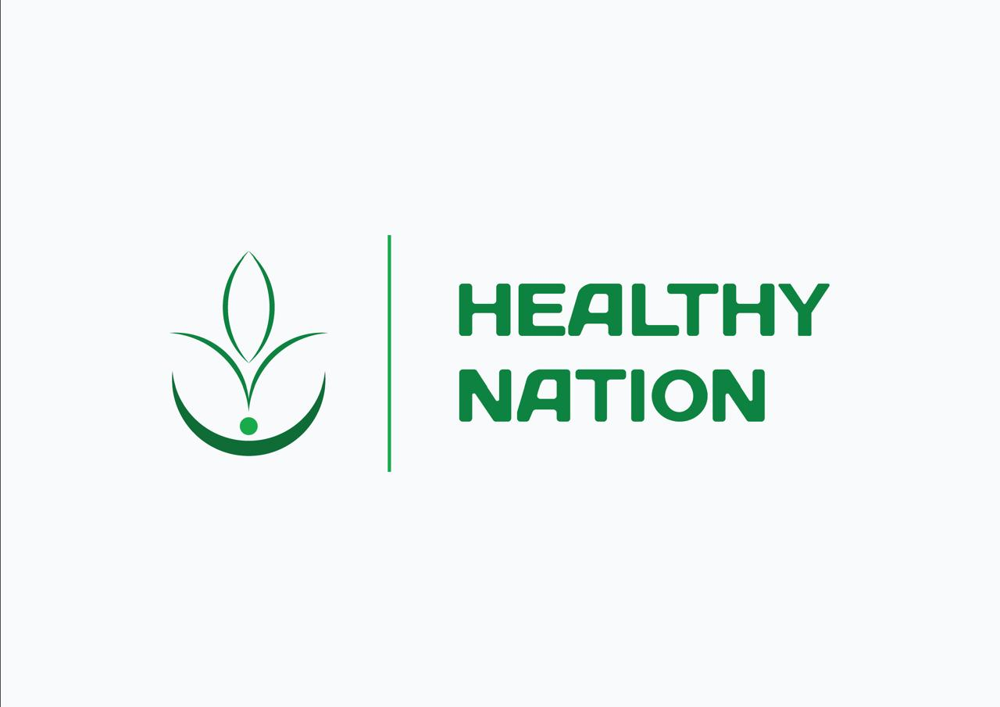

# Healthy Nation

A food website for finding meals, exploring meal-plan options and preparing WhatsApp requests.

**Status:** V1 runs locally with 55 priced dishes, 75 unique kitchen photos and reviewed WhatsApp requests. The Next.js + TypeScript app and editable JSON are in `web`. Dish photos remain labelled examples until exact matches are confirmed. Hosting, DNS, checkout and payments remain deferred.

Run the app from `web` with `npm ci` and `npm run dev`, then open `http://localhost:3000`. See the [development guide](docs/development.md) for static-build and preview commands.

## Documentation

Start with the [documentation index](docs/README.md).

- [Product brief and V1/V2/V3 roadmap](docs/product-brief.md)
- [System architecture proposal](docs/architecture.md)
- [Visual design and preview](docs/design/README.md)
- [Independent reviews and corrections](docs/reviews.md)
- [Customer reviews and improvements](docs/customer-reviews.md)
- [Questions for the founder](docs/founder-questions.md)
- [Local development guide](docs/development.md)
- [Editing founder, contact, and menu content](docs/content-editing.md)
- [Agent and contributor guidance](docs/AGENTS.md)

V1 is a read-only storefront with a WhatsApp handoff, not a checkout. The customer sends the message, and the business confirms the order separately.
